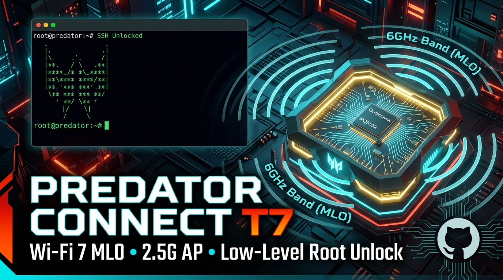

<p align="center">
  
</p>

<p align="center">
  <b>🌐 Idioma / Language:</b>
  <a href="README_PT.md"><b>🇧🇷 Português (Brasil)</b></a> |
  <a href="README.md">🇺🇸 English</a> |
  <a href="README_ES.md">🇪🇸 Español</a>
</p>

# Acer Predator Connect T7 — Desbloqueio Root, LuCI Nativo, Wi-Fi 7 & Redefinição de Fábrica

> **Status do Projeto (Outubro / 2026)**: Desbloqueio instantâneo em 1 minuto via restauração mestre nativa (`cfg_restauracao_master_v2.cfg`). Firmware oficial Acer com **interface LuCI nativa na Porta 80**, **Wi-Fi 7 (320 MHz / 5.76 Gbps)**, Roaming 802.11k/v, **Central de Wi-Fi Inteligente**, UPnP otimizado e debloat total de telemetrias. **Slot 1 (`rootfs`) e U-Boot mantidos 100% intactos de fábrica como salvaguarda anti-brick definitiva**.

> ⚠️ **AVISO CRÍTICO**: Execute sempre a configuração com o computador conectado via **cabo de rede (Ethernet)** em uma das portas LAN do roteador. Não realize o procedimento via Wi-Fi para não perder a conexão no meio do processo.

---

## ⚡ 1. RECOMENDAÇÃO PRÉVIA: ESTEJA NA VERSÃO v27
> [!TIP]
> **Recomendação Importante:**  
> Certifique-se de que o seu roteador esteja atualizado na **versão oficial v1.01.000027 (v27)** antes de aplicar o desbloqueio. A versão v27 traz as calibrações de rádio Wi-Fi 7 mais recentes, suporte total aos canais de 320 MHz e correções críticas no kernel Qualcomm.

---

## 🎁 2. BENEFÍCIOS DO DESBLOQUEIO (POR QUE DESBLOQUEAR?)

1. 🔓 **Acesso Root e SSH Nativo na LAN:** Portas `22` (SSH) e `23` (Telnet) liberadas na rede local sem travas da Acer.
2. 🌐 **Interface LuCI Oficial OpenWrt:** Painel completo na porta 80 com controle total de firewall, DHCP, rotas, VLANs e diagnósticos de processos.
3. 🚀 **Wi-Fi 7 Destravado:** Banda de 6 GHz com largura máxima de **320 MHz (5.76 Gbps)**, Roaming Rápido 802.11k/v e WPA3-SAE.
4. 🎛️ **Central de Wi-Fi Inteligente:** Exclusiva com ajustes e liberação máxima dos recursos do Wi-Fi, fácil e intuitiva. Permite alterar configurações e salvar todas as frequências juntas!
5. 🛡️ **Anti-Deadlock:** Eliminação definitiva dos módulos quebrados da Qualcomm (`whc` e `wsplc`) que causavam concorrência interna e instabilidade no Wi-Fi.
6. 🧹 **Debloat Máximo:** Desativação de telemetrias invasivas e serviços celulares inúteis herdados do modelo X7, liberando **mais de 50 MB de memória RAM**.
7. 🎮 **UPnP / NAT-PMP para Jogos:** Abertura automática de portas para PS5, Xbox, Switch e PC com NAT Aberto/Moderado e menor latência.
8. 🛡️ **Segurança Total Anti-Brick:** O Slot 1 e o U-Boot permanecem **100% de fábrica intactos**, com retorno garantido a qualquer momento: fez o reset pelo OpenWrt ou pelo botão físico já volta ao padrão de fábrica!
9. 🌐 **Idiomas 100% Organizados:** Interface LuCI e todos os novos menus customizados da Central de Wi-Fi perfeitamente localizados e alinhados em **Português (Brasil)**, **Inglês** e **Espanhol**, sem textos cortados ou confusos.

---

## 🛑 3. AVISO CRÍTICO: NUNCA RESTAURE BACKUPS ANTIGOS!

> [!CAUTION]
> ### ⚠️ REGRA DE OURO PÓS-DESBLOQUEIO:
> **Após desbloquear o roteador aplicando o nosso pacote mestre, JAMAIS restaure qualquer backup (`.cfg`) antigo feito antes do desbloqueio!**  
> Se você restaurar um backup antigo da interface de fábrica da Acer, ele vai **sobrescrever as configurações, apagar os arquivos de ajuste, deletar a interface LuCI e bloquear o SSH novamente**.  
>  
> 👉 **Como personalizar sua rede:**  
> Se você quiser mudar o nome do Wi-Fi, colocar sua própria senha ou alterar faixas de IP, **faça sempre manualmente pela tela da LuCI após o desbloqueio**.

---

## 🔑 4. CREDENCIAIS E DADOS PADRÃO APÓS A RESTAURAÇÃO

| Parâmetro | Configuração Padrão |
| :--- | :--- |
| **Endereço IP LAN** | **`192.168.76.1`** |
| **Interface Web (Porta 80)** | **`http://192.168.76.1/`** (LuCI OpenWrt) |
| **Usuário Web / SSH** | **`root`** (ou **`admin`**) |
| **Senha Mestra Unificada** | **`root0100`** *(Web, SSH e Telnet)* |
| **Arquivo do Pacote Mestre** | **`cfg_restauracao_master_v2.cfg`** *(na raiz do projeto)* |
| **Rede Wi-Fi 2.4 GHz** | **`PREDATOR T7_2.4GHz`** |
| **Rede Wi-Fi 5 GHz** | **`PREDATOR T7_5GHz`** |
| **Rede Wi-Fi 6 GHz (Wi-Fi 7)** | **`PREDATOR T7_6GHz`** |
| **Senha Wi-Fi (todas as redes)** | **`123456789`** |

---

## 🚀 5. PASSO A PASSO DA INSTALAÇÃO (1 MINUTO)

> ⚠️ **Conecte o computador via cabo de rede (Ethernet) na porta LAN do T7. Não faça pelo Wi-Fi.**

1. **Acesse a Tela Direta de Restauração:**  
   Abra o navegador e cole:
   ```text
   https://192.168.76.1/pub/dist/index.html#/system/backRestore
   ```
   *(Ou navegue: faça login ➔ Menu lateral `System` ➔ `Backup & restore`)*.
2. **Carregue o Arquivo Mestre:**  
   Na seção **Restore**:
   * Clique em **`Browse`** e selecione o arquivo:  
     `cfg_restauracao_master_v2.cfg`
   * Clique no botão **`Restore`**.
3. **Observe os LEDs durante o Boot:**
   * 🔴 **LED Frontal Vermelho:** É **normal** no 1º boot! O chip Qualcomm calibra os rádios e cumpre **60 segundos obrigatórios de escuta de radar (DFS CAC)** na faixa de 5 GHz. Aguarde cerca de **2 minutos e 25 segundos**.
   * 🔵 **LED Frontal Azul:** Assim que os 3 rádios subirem, a luz frontal comuta para **Azul**. O Wi-Fi está pronto para uso!
   * 🌐 **LED Superior Maior:** Só acende quando você conectar o cabo da internet na porta **WAN 2.5G**.
4. **Entre na Nova Interface LuCI:**  
   Acesse `http://192.168.76.1` e faça login com usuário `root` e senha `root0100`.

---

## 🔄 6. COMO REDEFINIR / RESETAR (3 NÍVEIS — APAGAR O DESBLOQUEIO E VOLTAR PARA STOCK)

### 🟢 Nível 1: Soft Reset (Restaurar mantendo o Desbloqueio e LuCI)
*Use se você desconfigurou o Wi-Fi ou a rede e quer voltar tudo para o padrão otimizado do projeto.*
* **Como fazer:** Acesse a tela de restauração e reaplique o arquivo `cfg_restauracao_master_v2.cfg`. O roteador volta zerado com LuCI e Wi-Fi 7 calibrados.

---

### 🟡 Nível 2: Hard Reset (Zerar 100% de Fábrica como veio de Loja)
*Use se for vender o roteador ou devolvê-lo para a garantia da Acer.*
* **Como fazer:**
  1. Com o roteador ligado, segure o botão **Reset** na parte traseira por **10 a 12 segundos** usando um clipe de papel.
  2. O roteador apaga a partição de dados (`overlay`) e volta para o firmware original bloqueado de fábrica da Acer.
  3. *(Para desbloquear de novo no futuro, basta reaplicar o Passo 5 deste guia).*

---

### 🔴 Nível 3: Modo de Emergência de Hardware (WPS Failsafe no IP `192.168.1.1` — Reinstalar ROM Oficial Stock)
*Use caso você trave a rede e o roteador não responda mais no IP 192.168.76.1.*  
Como o **U-Boot original da Acer está 100% intacto**, o aparelho nunca dá brick permanente. Nesta tela de baixo nível você pode regravar a **ROM Oficial Stock completa do fabricante** diretamente na memória flash:

> [!IMPORTANT]
> **Cuidados Obrigatórios para o Modo de Emergência:**
> 1. **Cabo de Rede Obrigatório:** O modo U-Boot de emergência não possui Wi-Fi. O computador DEVE estar conectado via cabo de rede na porta LAN do T7.
> 2. **Isolamento de Rede (Evitar Conflito de IP):** Conecte o computador **diretamente** ao roteador T7. Desconecte outros modems de operadora, roteadores secundários ou redes que possam estar usando a mesma faixa `192.168.1.1`. Desative o Wi-Fi do computador durante o procedimento.
> 3. **Navegador em Modo Anônimo:** Utilize uma janela de navegação anônima (ou limpe todo o cache do navegador) para garantir que páginas antigas não interfiram no carregamento da tela de emergência.

#### Passo a Passo para Subir a ROM Oficial:
1. Desligue a fonte de energia da tomada.
2. Segure pressionado o botão físico **WPS** na carcaça do T7.
3. Conecte a fonte de energia mantendo o botão **WPS pressionado por 8 a 10 segundos** até o LED começar a piscar em ritmo de recovery.
4. No seu computador, configure o IP manual da sua placa de rede Ethernet para:  
   * **Endereço IP:** `192.168.1.50`  
   * **Máscara de Sub-rede:** `255.255.255.0`  
   * **Gateway Padrão:** `192.168.1.1`  
5. Abra o navegador em modo anônimo e acesse:
   ```text
   http://192.168.1.1
   ```
6. Na página web de emergência da Acer (U-Boot Web Recovery):
   * Clique no campo de seleção de arquivo.
   * Selecione o arquivo de imagem da ROM Stock oficial da Acer:  
     👉 **`recovery_stock/nand-4k-ipq5332-single_101000027.img`** *(Versão v27 recomendada)*  
     *(ou `nand-4k-ipq5332-single_101000024.img` caso queira a v24)*.
   * Clique em **Upload / Upgrade**.
   * A gravação avançará escrevendo diretamente na memória flash NAND. Aguarde o processo concluir e o roteador reiniciar sozinho.
7. Retorne a placa de rede do seu computador para "Obter endereço IP automaticamente (DHCP)". O roteador voltará a responder no IP oficial `192.168.76.1` 100% original de fábrica.

---

## 🛠️ 7. NÍVEL DEV: ALTERNÂNCIA DE SLOTS DE BOOT (AVANÇADO)

> [!WARNING]
> ### 🛑 AVISO EXCLUSIVO PARA DESENVOLVEDORES:
> **Esta seção destina-se EXCLUSIVAMENTE a desenvolvedores e usuários com conhecimento avançado que desejam depurar, analisar e fuçar no sistema.**  
> Usuários comuns NÃO precisam executar comandos desta seção.

O Acer Predator Connect T7 conta com particionamento A/B duplo na memória NAND:
* **Slot 1 (`rootfs` / `mtd21`):** Firmware de fábrica OEM protegido.
* **Slot 2 (`rootfs_1` / `mtd20`):** Firmware OpenWrt Customizado com LuCI.

### Alternância pelo U-Boot Web Failsafe (`http://192.168.1.1`):
No modo de emergência U-Boot (pressionando WPS ao ligar), basta acessar `http://192.168.1.1` no navegador em modo anônimo e fazer o upload do arquivo binário desejado da pasta `dev/`:

#### Opção 1: Chaveadores Rápidos V1 (512 KB):
* **Para forçar o boot no Slot 1 (OEM de Fábrica):** Faça upload de 👉 **`dev/chaveador_slot1_acer_oem.bin`**
* **Para forçar o boot no Slot 2 (OpenWrt Custom):** Faça upload de 👉 **`dev/chaveador_slot2_openwrt.bin`**

#### Opção 2: Alternadores Avançados V2 com Verificação SHA e FIT Seguro (`dev/Alternador_Boot_T7_V2/`):
* **Para forçar o boot no Slot 1 (OEM de Fábrica):** Faça upload de 👉 **`dev/Alternador_Boot_T7_V2/selecionar_slot1_V2_CANDIDATO.bin`**
* **Para forçar o boot no Slot 2 (OpenWrt Custom):** Faça upload de 👉 **`dev/Alternador_Boot_T7_V2/selecionar_slot2_V2_CANDIDATO.bin`**
*(Os arquivos V2 são imagens FIT de U-Boot de 2.6 MB que inicializam a NAND, gravam ambas as partições `0:BOOTCONFIG` e `0:BOOTCONFIG1`, realizam checksum de integridade e reiniciam com segurança sem tocar no ambiente `APPSBLENV`).*

### Quando o roteador estiver desbloqueado (SSH / Telnet):
Não é necessário enviar arquivos nem comandos complexos de partição. Estando conectado via SSH (`porta 22`) ou Telnet (`porta 23`), basta executar os comandos nativos já integrados no sistema:
* **Para alternar para o Slot 1 (OEM de Fábrica):**
  ```sh
  /usr/sbin/boot-acer
  ```
* **Para alternar para o Slot 2 (OpenWrt Custom):**
  ```sh
  /usr/sbin/boot-openwrt
  ```
*O comando grava automaticamente o bootconfig na flash e reinicia o roteador no slot escolhido.*

---

## 📡 8. CHAMADA PARA A COMUNIDADE: MODELO PREDATOR X7 (5G CPE)

> [!IMPORTANT]
> ### 🤝 Você possui o modelo Acer Predator Connect X7?
> Ajude a comunidade enviando um backup do seu equipamento!  
> 
> * **Como colaborar:**  
>   1. No seu Predator X7, realize um reset de fábrica limpo pelo botão físico ou painel.  
>   2. Complete a primeira inicialização pelo painel web.  
>   3. Acesse a tela de backup (`System` ➔ `Backup & restore`) e baixe o arquivo `.cfg`.  
>   4. Envie o arquivo para nós através de um dos canais da comunidade:  
>      * 👉 **Abrindo uma Issue no GitHub:** [GitHub Issues do Projeto](https://github.com/Despensativo/Acer-Predator-Connect-T7-Wi-Fi-7/issues)  
>      * 👉 **Pelo Fórum OpenWrt:** Respondendo ou enviando mensagem privada no [Tópico Oficial do Projeto](https://forum.openwrt.org/t/research-guide-acer-predator-connect-t7-qualcomm-ipq5332-wi-fi-7-root-shell-unlock-2-5gbps-ap-mode-mtd-backups/254042)  
> * **Por que isso é importante?**  
>   O X7 compartilha o mesmo processador do T7, porém possui um modem celular 5G M.2 (Snapdragon X62). Com o seu backup de fábrica limpo, poderemos estudar a fundo as tabelas de partição e o módulo 5G para criarmos um pacote mestre sob medida com a mesma precisão do T7!

---

## 🤝 9. AGRADECIMENTOS ESPECIAIS & CRÉDITOS

* 🏆 **Agradecimento Especial a [Diego Augusto (BESTYALL)](https://forum.openwrt.org/u/bestyall):**  
  Um agradecimento fundamental a **[Diego Augusto](https://forum.openwrt.org/u/bestyall)** por sua coragem e dedicação pioneira ao arriscar seu próprio roteador físico nos estágios iniciais do projeto. Seus testes exaustivos de bancada, relatórios de comportamento em tempo real e feedbacks detalhados foram peças-chave para o aperfeiçoamento e maturação definitiva desta solução de desbloqueio!

* 🌐 **Idiomas 100% Organizados e Localizados:**  
  Graças aos testes e contribuições da comunidade, a ROM conta agora com todos os idiomas perfeitamente organizados e integrados. A interface LuCI e todos os novos menus customizados da **Central de Wi-Fi Inteligente** estão 100% traduzidos e adaptados em **Português (Brasil)**, **Inglês** e **Espanhol**, garantindo uma experiência nativa, clara e intuitiva para configurar cada detalhe do Wi-Fi 7 sem textos truncados ou termos faltando.

---

<p align="center">
  <b>Desenvolvido pela Comunidade OpenWrt & Engenharia Reversa Independente</b><br>
  Licença MIT — Livre para uso, estudo e aprimoramento.
</p>
