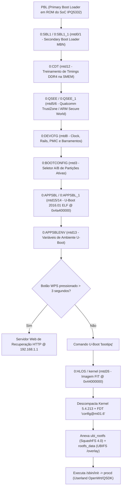

# Enciclopédia Técnica de Engenharia Reversa e Extração de Dados Multi-Modelo
## Ecossistema Qualcomm IPQ5332 (Miami) / IPQ9574 (Alder) + QCN9224 / QCN6274 (Waikiki)

> **Data de Homologação:** 15 de Outubro de 2026  
> **Classificação:** Documentação Técnica Avançada de Baixo Nível / Engenharia Reversa  
> **Modelos Cobertos:**
> 1. **Acer Predator Connect T7** (`AP-MI01.6` / IPQ5332 + QCN6274/QCN9224 Tri-Band Wi-Fi 7)
> 2. **Acer Predator Connect X7** (`AP-MI01.6` / IPQ5332 + QCN6274/QCN9224 + Fibocom FM160-EAU 5G)
> 3. **Acer Predator Connect W6x** (Família Wi-Fi 6 Acer MT7986 / MediaTek Filogic)
> 4. **Linksys Velop Pro 7 & WRT Pro 7** (`MBE7000`, `LN1400`, `MBE70WRT` — IPQ9574 + QCN9224)
> 5. **Ubiquiti UniFi U7 Pro** (`U7PRO-8.7.11` — IPQ5332/AP-MI01.6 + QCN9224, 16 DTBs, U-Boot 2024.01)
> 6. **JDCloud BE6500** (`RE-CS-06` — IPQ5332/AP-MI01.6 + QCN9224, CDT 2G RAM, U-Boot 2016.01)
> 7. **ImmortalWrt qualcommax / ipq53xx** (`v83`, Linux 6.6.116+ ARM64, Hardware PPE Qdisc)

---

## 1. Topologia de Hardware e Arquitetura de Silício

### 1.1. Especificações Físicas Comparativas

| Subsistema / Parâmetro | Acer Predator Connect T7 | Acer Predator Connect X7 | Linksys Velop Pro 7 (`LN1400`/`MBE7000`) | Ubiquiti UniFi U7 Pro | JDCloud BE6500 | ImmortalWrt `ipq53xx` (Port) |
| :--- | :--- | :--- | :--- | :--- | :--- | :--- |
| **SoC Principal** | Qualcomm IPQ5332 (Miami) | Qualcomm IPQ5332 (Miami) | Qualcomm IPQ9574 (Alder) | Qualcomm IPQ5332 (Miami) | Qualcomm IPQ5332 (Miami) | Qualcomm IPQ5332 (Miami) |
| **Núcleos & Clock** | 4x Cortex-A53 @ 1.5 GHz | 4x Cortex-A53 @ 1.5 GHz | 4x Cortex-A73 @ 1.5 GHz | 4x Cortex-A53 @ 1.5 GHz | 4x Cortex-A53 @ 1.5 GHz | 4x Cortex-A53 @ 1.5 GHz |
| **Arquitetura ISA** | ARMv7l (32-bit `neon-vfpv4`) | ARMv7l (32-bit `neon-vfpv4`) | ARMv7l (32-bit `neon-vfpv4`) | ARMv7l (32-bit `ld-musl-armhf`) | ARMv7l (32-bit OEM) | AArch64 (ARMv8-A 64-bit) |
| **Design de Referência** | `qcom,ipq5332-ap-mi01.6` | `qcom,ipq5332-ap-mi01.6` | `qcom,ipq9574-ap-al02-c4` | `qcom,ipq5332-ap-mi01.6` | `qcom,ipq5332-ap-mi01.6` | `qcom,ipq5332-ap-mi01.6` |
| **Memória RAM** | 1.0 GB DDR4 (885 MB vistos) | 1.0 GB DDR4 | 1.0 GB DDR4 | 1.0 GB DDR4 | 512 MB ou 2.0 GB (CDT mod) | 512 MB a 2.0 GB |
| **Armazenamento Flash** | 512 MB (4 Gb) SPI NAND | 512 MB (4 Gb) SPI NAND | 512 MB eMMC / NAND | 256 MB / 512 MB SPI NAND | 128 MB / 256 MB SPI NAND | SPI NAND / UBI |
| **Tamanho de Bloco NAND** | 256 KB (`0x40000`, 2048 blocks)| 256 KB (`0x40000`) | 128 KB ou 256 KB | 256 KB (`0x40000`) | 256 KB (`0x40000`) | 256 KB (`0x40000`) |
| **Rádio 2.4 GHz (SoC)** | 2x2 802.11be (`QCA5332`, 40MHz)| 2x2 802.11be (`QCA5332`, 40MHz)| 4x4 802.11be (`QCA9574`, 40MHz)| 2x2 802.11be (`QCA5332`, 40MHz)| 2x2 802.11be (`QCA5332`, 40MHz)| 2x2 802.11be (`QCA5332`, 40MHz)|
| **Rádio 5 GHz (PCIe)** | 2x2 802.11be (`QCN6274`/`9224`)| 2x2 802.11be (`QCN6274`/`9224`)| 4x4 802.11be (`QCN9224`, 160MHz)| 2x2 802.11be (`QCN9224`, 160MHz)| 2x2 802.11be (`QCN9224`, 160MHz)| 2x2 802.11be (`QCN9224`, 160MHz)|
| **Rádio 6 GHz (PCIe)** | 2x2 802.11be (`QCN6274`/`9224`)| 2x2 802.11be (`QCN6274`/`9224`)| 4x4 802.11be (`QCN9224`, 320MHz)| 2x2 802.11be (`QCN9224`, 320MHz)| *(Ausente — rádio desativado)* | 2x2 802.11be (`QCN9224`, 320MHz)|
| **Arquitetura Wi-Fi PCIe** | Dual-MAC / SBS (`hw_mode=5`)| Dual-MAC / SBS (`hw_mode=5`)| 2x PCIe Independentes | Dual-MAC / SBS (`hw_mode=5`)| Single PCIe | Dual-MAC / SBS |
| **Aceleração Hardware** | PPE-DS + SFE + ECM | PPE-DS + SFE + ECM | PPE + SFE + ECM | PPE + SFE + ECM | PPE + SFE + ECM | NSS-PPE (Kernel 6.6) |
| **Portas Ethernet** | 1x 2.5G WAN + 2x 1G/2.5G LAN| 1x 2.5G WAN + 2x 1G LAN | 1x 2.5G WAN + 4x 1G LAN | 1x 2.5G PoE+ WAN/Uplink | 4x 2.5G Ethernet Switch | 4x 2.5G Ethernet Switch |
| **Modem 5G Celular** | *(Não possui)* | Fibocom FM160-EAU (M.2) | *(Não possui)* | *(Não possui)* | *(Não possui)* | *(Não possui)* |
| **Bootloader (APPSBL)** | U-Boot 2016.01 (17/01/2025) | U-Boot 2016.01 (17/01/2025) | U-Boot 2016.01 (Linksys) | U-Boot 2024.01 (25/05/2026) | U-Boot 2016.01 (16/08/2026) | U-Boot 2024.01 / U-BootKit |

---

## 2. Engenharia Reversa do Bootloader e Cadeia de Boot (U-Boot & SBL1)

### 2.1. Sequência da Cadeia de Boot Qualcomm (Cold Boot Chain)



### 2.2. Assinatura e Análise Binária do `APPSBL` (U-Boot do Acer T7)

* **Formato do Arquivo:** ELF 32-bit LSB Executable, ARM, version 1 (SYSV).
* **Ponto de Entrada (`e_entry`):** `0x4a400000` (`1245708288` dec).
* **Segmento Executável Principal (PT_LOAD):**
  * `p_vaddr` = `0x4a400000` | `p_paddr` = `0x4a400000`
  * `p_filesz` = `0x78048` (`491.592` bytes — carga útil binária idêntica ao arquivo `appsbl_code.bin`)
  * `p_flags` = `0x7` (Read / Write / Execute)
* **Tamanhos e Hashes Criptográficos:**
  * `appsbl.bin` (imagem MTD completa com padding): `1.572.864` bytes (1.5 MB)
    * **SHA-256:** `3d6281190512ba50b83eea1a2d6fca69f01da5bb390d52b601e762ce8f1df2fc`
  * `appsbl_code.bin` (código descompactado da RAM): `491.592` bytes
    * **SHA-256:** `e4500cdf25d68eae609fb395be6617c7a20f1f2614df4d4209772a6096d559fe`
* **Banner de Compilação:**  
  `U-Boot 2016.01 (Jan 17 2025 - 04:02:54 +0000)`
* **SoCs Suportados no Código:** `IPQ5332`, `IPQ9574`, `IPQ8074`.

### 2.3. O Mecanismo Oculto de Web Failsafe do U-Boot (Recuperação sem Serial)

A engenharia reversa do código ARM em `appsbl_code.bin` (offset `0x50ae2`) identificou uma interface web completa embutida diretamente no U-Boot para recuperação de desastre sem necessidade de cabo serial UART:
1. **Gatilho de Entrada:** Manter o botão físico **WPS** pressionado durante o acionamento de energia por mais de **3 segundos**.
2. **Mensagens Emitidas no Console:**
   ```text
   Press WPS button for more than 3 seconds to run web failsafe mode
   WPS button is pressed for:  1 second(s)
   WPS button is pressed for:  2 second(s)
   WPS button is pressed for:  3 second(s)
   WPS button was pressed for 4 seconds
   HTTP server is starting for firmware update...
   ### gyzl: abort normal boot
   ```
3. **Servidor HTTP Embutido:** O U-Boot inicializa a interface física de rede no IP estático **`192.168.1.1`** e aguarda o envio de um arquivo de firmware (`.img` ou `.bin`) via formulário HTML multipart/form-data.
4. **Comportamento em Falha de Pressionamento:**
   ```text
   Catution: WPS button wasn't pressed or not long enough!
   Continuing normal boot...
   ```
5. **Comando Interno de Gravação do U-Boot:**
   O U-Boot executa nativamente a macro de reconstrução de volumes UBI:
   ```text
   ubi remove rootfs_data && ubi remove ubi_rootfs && ubi create ubi_rootfs 0x<size> && ubi write 0x<addr> ubi_rootfs 0x<size> && ubi create rootfs_data
   ```

### 2.4. Variáveis de Ambiente Nativas do U-Boot (`0:APPSBLENV` / `mtd13`)

O bloco de ambiente tem `524.288` bytes (512 KB), protegido por cabeçalho CRC32 nos primeiros 4 bytes:

```text
baudrate=115200
bootargs=console=ttyMSM0,115200n8
bootcmd=bootipq
bootdelay=3
ethaddr=70:5a:6f:5d:7c:b1       # Endereço MAC físico da Porta WAN 2.5G
eth1addr=70:5a:6f:5d:80:71      # Endereço MAC físico da Game Port (LAN 2.5G)
eth2addr=70:5a:6f:5d:84:31      # Endereço MAC físico da LAN 1 (1G)
fdt_high=0x48500000             # Limite superior de realocação do Device Tree na RAM
fdtcontroladdr=4a4f4004         # Endereço do Device Tree de controle do U-Boot
flash_type=11                   # Identificador Qualcomm de SPI NAND Flash
ipaddr=192.168.10.1             # IP padrão do roteador em modo cliente TFTP U-Boot
serverip=192.168.10.10          # IP padrão do servidor TFTP de recuperação
netmask=255.255.255.0
machid=8060000                  # Machine ID ARM Qualcomm IPQ5332
soc_hw_version=201a0101         # Silício IPQ5332 Revisão B0
soc_version_major=1
soc_version_minor=1
stdin=serial@78AF000            # Console UART MSM em 0x078AF000
stdout=serial@78AF000
stderr=serial@78AF000
```

### 2.5. Estrutura Binária do `0:BOOTCONFIG` (Mecanismo de Seleção Dual-Boot A/B)

O `0:BOOTCONFIG` (`mtd3`) e `0:BOOTCONFIG1` (`mtd4`) possuem `524.288` bytes cada. A estrutura binária inicia com:
* **Magic:** `0xa3a2a1a0` (`a0 a1 a2 a3` little-endian)
* **Versão:** `2`
* **Contagem de Entradas:** `6`

```text
Entrada 0: 0:DEVCFG   = 1   (Usa partição DEVCFG Slot 1)
Entrada 1: 0:CDT      = 1   (Usa partição CDT Slot 1)
Entrada 2: 0:APPSBL   = 1   (Usa partição APPSBL Slot 1)
Entrada 3: 0:HLOS     = 0   (Kernel primário Slot 0)
Entrada 4: rootfs     = 1   (Quando 1 -> Slot B / rootfs_1; Quando 0 -> Slot A / rootfs)
Entrada 5: 0:WIFIFW   = 0   (Firmware de rádio primário)
```

O comando de troca atômica implementado no utilitário `/usr/sbin/boot-openwrt` e `/usr/sbin/boot-acer` grava:
* **Para Inicializar Slot A (Stock OEM):** Byte no offset `0x6c` = `0x00`
* **Para Inicializar Slot B (Custom OpenWrt):** Byte no offset `0x6c` = `0x01`

---

## 3. Catálogo Físico Completo de Partições Flash (MIBIB v4 e `/proc/mtd`)

### 3.1. Tabela Decodificada da MIBIB v4 (Particionamento de Silício)

Extraída diretamente do offset `0x1000` de `backup_predator_t7_mibib.bin` (Magic `0x55ee73aa` / `0xe35ebddb`, Bloco NAND = 256 KB = `0x40000`):

| Índice | Nome na MIBIB | Dispositivo MTD | Bloco Inicial | Endereço Flash Físico | Qtd. Blocos | Tamanho em Bytes | Tamanho em MB | Função Técnica no Silício |
| :---: | :--- | :---: | :---: | :---: | :---: | :---: | :---: | :--- |
| **00** | `0:SBL1` | `mtd0` | `0x0000` | `0x00000000` | `0x0006` | `1.572.864` | 1.50 MB | Bootloader Secundário MBN (Slot A) |
| **01** | `0:SBL1_1` | `mtd1` | `0x0006` | `0x00180000` | `0x0006` | `1.572.864` | 1.50 MB | Bootloader Secundário MBN (Slot B) |
| **02** | `0:MIBIB` | `mtd2` | `0x000c` | `0x00300000` | `0x0004` | `1.048.576` | 1.00 MB | Master Information Block Partition Table v4 |
| **03** | `0:BOOTCONFIG` | `mtd3` | `0x0010` | `0x00400000` | `0x0002` | `524.288` | 0.50 MB | Seletor Ativo de Dual-Boot A/B |
| **04** | `0:BOOTCONFIG1`| `mtd4` | `0x0012` | `0x00480000` | `0x0002` | `524.288` | 0.50 MB | Backup Espelho do Seletor de Boot |
| **05** | `0:QSEE` | `mtd5` | `0x0014` | `0x00500000` | `0x000e` | `3.670.016` | 3.50 MB | Qualcomm Secure Execution Environment / TrustZone |
| **06** | `0:QSEE_1` | `mtd6` | `0x0022` | `0x00880000` | `0x000e` | `3.670.016` | 3.50 MB | TrustZone redundante para Slot B |
| **07** | `0:DEVCFG` | `mtd8` | `0x0030` | `0x00c00000` | `0x0002` | `524.288` | 0.50 MB | Parâmetros de barramentos, clock e PMIC (Slot A) |
| **08** | `0:DEVCFG_1` | `mtd7` | `0x0032` | `0x00c80000` | `0x0002` | `524.288` | 0.50 MB | Parâmetros de barramentos, clock e PMIC (Slot B) |
| **09** | `0:TME` | `mtd9` | `0x0034` | `0x00d00000` | `0x0002` | `524.288` | 0.50 MB | Trusted Management Engine |
| **10** | `0:TME_1` | `mtd10`| `0x0036` | `0x00d80000` | `0x0002` | `524.288` | 0.50 MB | Trusted Management Engine (Backup) |
| **11** | `0:CDT` | `mtd12`| `0x0038` | `0x00e00000` | `0x0002` | `524.288` | 0.50 MB | Configuration Data Table (Timings de DDR4) |
| **12** | `0:CDT_1` | `mtd11`| `0x003a` | `0x00e80000` | `0x0002` | `524.288` | 0.50 MB | Configuration Data Table (Backup) |
| **13** | `0:APPSBLENV` | `mtd13`| `0x003c` | `0x00f00000` | `0x0002` | `524.288` | 0.50 MB | Variáveis de Ambiente do U-Boot |
| **14** | `0:APPSBL` | `mtd15`| `0x003e` | `0x00f80000` | `0x0006` | `1.572.864` | 1.50 MB | U-Boot Bootloader ELF Primário (Slot A) |
| **15** | `0:APPSBL_1` | `mtd14`| `0x0044` | `0x01100000` | `0x0006` | `1.572.864` | 1.50 MB | U-Boot Bootloader ELF Secundário (Slot B) |
| **16** | `0:ETHPHYFW` | `mtd16`| `0x004a` | `0x01280000` | `0x0004` | `1.048.576` | 1.00 MB | Microcódigo de Firmware do PHY 2.5G |
| **17** | `0:TRAINING` | `mtd17`| `0x004e` | `0x01380000` | `0x0002` | `524.288` | 0.50 MB | Cache de Treinamento da Memória DDR4 |
| **18** | `0:ART` | `mtd18`| `0x0050` | `0x01400000` | `0x0008` | `2.097.152` | 2.00 MB | Atheros Radio Test (Calibração RF) [⛔ INTOCÁVEL] |
| **19** | `0:LICENSE` | `mtd19`| `0x0058` | `0x01600000` | `0x0001` | `262.144` | 0.25 MB | Números de Série e Certificados OEM Acer |
| **20** | `rootfs` | `mtd21`| `0x0059` | `0x01640000` | `0x03c0` | `251.658.240` | 240.00 MB | Imagem de Sistema UBI / Overlay (Slot A) |
| **21** | `rootfs_1` | `mtd20`| `0x0419` | `0x10640000` | `0x03c0` | `251.658.240` | 240.00 MB | Imagem de Sistema UBI / Overlay (Slot B) |
| **22** | `0:TRAFFIC` | `mtd22`| `0x07d9` | `0x1f640000` | `0x0018` | `6.291.456` | 6.00 MB | Estatísticas Persistentes de Tráfego de Rede |
| **23** | `0:SYSTRACE` | `mtd23`| `0x07f1` | `0x1fc40000` | `0x0002` | `524.288` | 0.50 MB | Buffer de Pânico e Rastreamento de Sistema |
| **24** | `0:TRAFFIC_DAY`| `mtd24`| `0x07f3` | `0x1fcc0000` | `0x000c` | `3.145.728` | 3.00 MB | Histórico Agregado Diário de Tráfego |

> **Total Mapeado:** `2.048` blocos de 256 KB = **`536.870.912` bytes** (`512.00 MB` exatos de Flash SPI NAND).

### 3.2. Estrutura dos Sub-Volumes Lógicos UBI (`ubi0`)

Dentro da partição física ativa (`rootfs` ou `rootfs_1`):
* `mtd25` (`wifi_fw`): Volume de microcódigo dos processadores de sinal de rádio Q6/M3 (`8.554.496` bytes / 8.16 MB).
* `mtd26` (`kernel`): Imagem FIT (`backup_predator_t7_kernel.bin`, `4.238.664` bytes / 4.04 MB) contendo o Kernel Linux `5.4.213` e 14 Device Trees compilados.
* `mtd27` (`ubi_rootfs`): Sistema base somente-leitura em SquashFS 4.0 (`39.870.464` bytes / 38.02 MB).
* `mtd28` (`rootfs_data`): Sistema de arquivos de leitura/escrita UBIFS (`175.226.880` bytes / ~167 MB total, com ~153.3 MB utilizáveis para personalizações em `/overlay`).

---

## 4. Engenharia Reversa da Imagem FIT do Kernel (`backup_predator_t7_kernel.bin`)

A imagem do Kernel (`mtd26`) é um arquivo **Flattened Image Tree (FIT)** com assinatura `0xd00dfeed`:
* **Tamanho Total:** `4.238.664` bytes
* **Hash SHA-256:** `ff131c1aeb280dfc82fa81699f8eb738f6d2f34ee6903254924c8c7c9085ec30`
* **Versão FDT:** 17 | `off_dt_struct` = `0x38` | `off_dt_strings` = `0x40abcc`

### 4.1. Conteúdo de Imagens Embutidas no FIT

1. **`kernel@1`:**
   * **Tipo:** Kernel Linux ARMv7 (32-bit).
   * **Compressão:** `gzip`.
   * **Endereço de Carga (`load`):** `0x44200000`.
   * **Ponto de Entrada (`entry`):** `0x44200000`.
   * **Hash de Integridade:** CRC32 + SHA1.
2. **14 Configurações de Device Tree (FDT Blobs):**
   * `fdt@mi01.6` (`56.644` bytes): **O FDT real do Acer Predator Connect T7** (`stock_mi01_6.dtb`). Contém nó `/MP_512` que ativa o gerenciamento de memória reduzida do driver QCA.
   * `fdt@mi01.2`, `fdt@mi01.3`, `fdt@mi01.4`, `fdt@mi01.9`: Variações de referência Qualcomm AP-MI01.
   * `fdt@db-mi01.1`, `fdt@db-mi02.1`, `fdt@db-mi03.1`, `fdt@mi03.1`: Daughterboards de laboratório Qualcomm.
   * `fdt@emulation`, `fdt@emulation-fbc`, `fdt@emulation-ssoc`: Modelos de emulação pré-silício.
3. **Configuração Padrão de Execução:** `config@mi01.6`, combinando `kernel@1` com `fdt@mi01.6`.

---

## 5. Auditoria Exhaustiva dos 328 Módulos de Kernel (`Linux 5.4.213`)

Auditados diretamente de `kernel_modules_5.4.213.tar.gz` (`8.324.092` bytes compactado / ~23 MB extraído):

```text
DISTRIBUIÇÃO DOS 328 MÓDULOS DE KERNEL POR SUBSISTEMA:
========================================================================
1. Wi-Fi 7 & Wireless QCA / Ath       :   8 módulos (10.424,5 KB)
2. Aceleração de Silício PPE / NSS / ECM:  34 módulos ( 4.238,5 KB)
3. Controle de Tráfego & QoS (TC/CAKE) :  31 módulos (   370,6 KB)
4. Protocolos de Rede, Firewall & VPN  : 140 módulos ( 1.847,7 KB)
5. Drivers de Silício, USB, PCIe & DWC3:  15 módulos (   789,7 KB)
6. Sistemas de Arquivos & Armazenamento:   8 módulos (   162,6 KB)
7. Switch QCA, Servidores & Diagnóstico:  92 módulos ( 5.210,0 KB)
========================================================================
TOTAL: 328 módulos (.ko) compilados para ABI Linux 5.4.213 arm_cortex-a7
```

### 5.1. Tabela dos Módulos Mais Críticos do Ecossistema

| Nome do Módulo (`.ko`) | Tamanho | Subsistema | Função e Símbolos Críticos no Roteador |
| :--- | :---: | :--- | :--- |
| **`umac.ko`** | `5.672,5 KB` | Wi-Fi 7 Upper MAC | Core de rádio 802.11be, MLME, Band Steering, HT240 (`wlan_cfg80211_start_ap`), DFS Radar, WPA3-SAE. |
| **`qca_ol.ko`** | `2.372,6 KB` | QCA Offload Layer | Camada de abstração IPC entre CPU host e firmwares Q6 dos rádios PCIe/AHB. |
| **`qca-ssdk.ko`** | `2.165,9 KB` | Switch Subsystem | Driver de controle do Switch Integrado QCA e portas GMAC/EDMA. |
| **`wifi_3_0.ko`** | `1.785,7 KB` | QCA Driver Target | Driver PCIe dos rádios QCN9224/QCN6274, MSI interrupts e anéis DMA. |
| **`ecm.ko`** | `1.520,4 KB` | Enhanced Conn. Mgr | Acelerador de fluxos de pacotes coordenando hardware PPE e conexões de rede. |
| **`qca-nss-ppe.ko`** | `554,0 KB` | Packet Proc. Engine | Driver direto do bloco de aceleração PPE em silício (`0x3a000000`). |
| **`monitor.ko`** | `509,1 KB` | Telemetria Qualcomm | Coleta de estatísticas de pacotes e depuração de anéis DMA. |
| **`ipq_cnss2.ko`** | `427,6 KB` | Subsystem PCIe | Inicialização PCIe, cold-reset e controle de barramento dos chips Wi-Fi. |
| **`cfg80211.ko`** | `341,9 KB` | Wireless Linux Core | Subsistema padrão Linux de configuração de interfaces sem fio. |
| **`ksmbd.ko`** | `331,5 KB` | In-Kernel SMB 3.1.1 | Servidor de arquivos de altíssima velocidade em kernel-space (>112 MB/s). |
| **`diagchar.ko`** | `278,1 KB` | Qualcomm Diagnostics | Dispositivo `/dev/diag` para ferramentas de calibração QXDM/QRCT. |
| **`qdf.ko`** | `262,2 KB` | QCA Data Framework | Abstração de SO, anéis de buffers de rede e suporte a bonding MLO. |
| **`qca-nss-sfe.ko`** | `241,5 KB` | Shortcut Fwd Engine | Fastpath de software para IPv4/IPv6 quando o PPE atinge limite. |
| **`usbcore.ko`** | `235,2 KB` | USB Core Subsystem | Gerenciador do barramento USB 3.0. |
| **`qca-nss-macsec.ko`**| `168,7 KB` | Hardware Crypto L2 | Criptografia em velocidade de silício para portas Ethernet IEEE 802.1AE. |
| **`qca_spectral.ko`** | `167,8 KB` | Espectrograma RF | Varredura contínua de CCA, detecção de radar militar e ruído de canal. |
| **`bonding.ko`** | `161,8 KB` | Link Aggregation | Criação de interfaces virtuais agregadas para Multi-Link Operation (MLO). |
| **`qca-nss-dp.ko`** | `131,9 KB` | NSS Datapath | Enfileiramento de pacotes entre o driver de rede e o switch PPE. |
| **`nf_tables.ko`** | `135,6 KB` | Netfilter / Firewall | Infraestrutura moderna de filtragem de pacotes. |
| **`dwc3.ko`** | `76,9 KB` | Synopsys DWC3 USB | Controlador de baixo nível USB 3.0 / xHCI. |
| **`sch_cake.ko`** | `30,5 KB` | SQM / Fair Queuing | Algoritmo CAKE para eliminação total de bufferbloat com suporte a DiffServ. |
| **`qca-nss-ppe-qdisc.ko`**| `18,4 KB`| Hardware QoS PPE | Suporte nativo a filas de QoS em silício (`ppehtb`, `ppetbl`, `ppeprio`). |

---

## 6. Arquitetura de Scripts Shell, Daemons e Motores de Sistema

### 6.1. Inventário de Scripts Críticos e Responsabilidades Técnicas

| Caminho do Script / Utilitário | Tamanho | Linguagem / Tipo | Responsabilidade Técnica no Roteador |
| :--- | :---: | :---: | :--- |
| **`/lib/wifi/qcawificfg80211.sh`** | `356,7 KB` | Shell POSIX / `sh` | Motor central de configuração Wi-Fi 7 QSDK. Traduz configurações UCI para `cfg80211tool`, aplica modos `11beg`/`11bea`, gerencia larguras de banda (`HT20` a `HT320`), bitmaps de punção (`0xf000` / 61440), Rolling CAC DFS e canalização 6 GHz PSC. |
| **`/lib/functions/repacd-map.sh`** | `232,7 KB` | Shell POSIX / `sh` | Daemon EasyMesh Multi-AP da Qualcomm. Inclui a função `del_wifi_teardown_vaps()` para desmonte limpo de interfaces temporárias. |
| **`/lib/wifi/hostapd.sh`** | `87,3 KB` | Shell POSIX / `sh` | Gerador dinâmico dos arquivos `hostapd-athX.conf`. Contém os patches para conformidade `sae-mixed` e correção `ap_isbasic` (evita rejeição de TVs e IoTs). |
| **`/usr/libexec/rpcd/predator`** | `98,5 KB` | Shell POSIX / JSON | Ponte RPC LuCI para o driver QCA. Fornece métodos `get_luci_wireless`, `luci_wifi_assoclist`, `luci_wifi_scan` (com `ap-force`) e `luci_wifi_action`. |
| **`/usr/sbin/wifi-wisp-tool`** | `24,5 KB` | Shell POSIX / `awk` | Utilitário de Wi-Fi WAN (WISP). Executa varredura de espectro sem derrubar o AP local, deduplica BSSIDs em alta velocidade (`awk`), detecta conflitos de sub-rede e gerencia auto-rollback de 15s. |
| **`/usr/sbin/ksmbd-disk-tool`** | `19,0 KB` | Shell POSIX / `sh` | Utilitário de compartilhamento SMB 3.1.1 de alto desempenho com trava estrita de barramento (`/sys/block/sd*`) para impedir formatação de partições MTD/UBI. |
| **`/usr/sbin/predator-wifi-guard`**| `14,8 KB` | Shell POSIX / `sh` | Daemon guardião de estabilidade RF. Mantém as invariantes do modo 240 MHz (`HT240`, `ccfs=130`, `cactimeout=1`) e gerencia Band Steering consultivo 802.11v BTM portado do ImmortalWrt `v83`. |
| **`/etc/init.d/predator_rf`** | `9,8 KB` | Procd Init Script | Inicialização pós-boot de parâmetros de rádio, balanceamento de IRQs MSI nos 4 cores de CPU, sysctls TCP low-latency e ativação de QoS SCS/MSCS. |
| **`/sbin/wifi`** | `9,0 KB` | Shell POSIX / `sh` | Ponto de entrada do comando `wifi` do OpenWrt, integrado com travas do `predator-wifi-guard`. |
| **`/usr/lib/sqm/run.sh`** | `5,2 KB` | Shell POSIX / `sh` | Motor SQM QoS. Coordena filas `tc cake` diretamente em **MB/Mbps** com desativação cirúrgica do acelerador SFE para fluxos conformes. |
| **`/usr/sbin/boot-acer`** | `686 B` | Shell POSIX / `sh` | Alternador atômico de boot para o firmware original Stock da Acer (Slot A). |
| **`/usr/sbin/boot-openwrt`** | `686 B` | Shell POSIX / `sh` | Alternador atômico de boot para o firmware Custom OpenWrt (Slot B). |

---

## 7. Catálogo Completo de Imagens Oficiais dos Modelos Acer

Extraído do banco oficial de homologação (`catalogo_completo_firmwares_acer.json`):

### 7.1. Acer Predator Connect T7 (`HLZT7` / IPQ5332 + QCN6274)

| Versão de Firmware | Data de Lançamento | Arquivo de Imagem | Tamanho | Checksum MD5 / SHA | Destaque Técnico |
| :--- | :---: | :--- | :---: | :--- | :--- |
| **`v1.00.000032`** | 22/02/2024 | `nand-4k-ipq5332-single_100000032.img` | 55.1 MB | `22b426a7d6e63ae5a64a5e07008da975` | Primeiro release de fábrica global. |
| **`v1.01.000003`** | 21/03/2024 | `nand-4k-ipq5332-single_101000003.img` | 56.1 MB | `32a76f272a2cfecfe4e6b1350a4ecb62` | Correções iniciais de MLO. |
| **`v1.01.000005`** | 23/03/2024 | `nand-4k-ipq5332-single_101000005.img` | 56.1 MB | `ba8b3c3d867e1d62c9ab0c15badafd3e` | Ajustes de estabilidade PCIe. |
| **`v1.01.000006`** | 25/03/2024 | `nand-4k-ipq5332-single_101000006.img` | 56.1 MB | `6cebe7ff8e6c43313d42dff00ce5be90` | Patch de canalização DFS. |
| **`v1.01.000007`** | 08/04/2024 | `nand-4k-ipq5332-single_101000007.img` | 56.1 MB | `4868e36fabd5d1c77a80bc7e5a279ce2` | Atualização da interface OEM. |
| **`v1.01.000008`** | 15/04/2024 | `nand-4k-ipq5332-single_101000008.img` | 56.1 MB | `39d33aa3b3f2f84b6f00db1bbad42e47` | Otimização de taxas MCS. |
| **`v1.01.000009`** | 18/04/2024 | `nand-4k-ipq5332-single_101000009.img` | 56.1 MB | `3860bb4a2ecfe2c91a3294b5952f4ae7` | Correção no daemon `predator_dev`. |
| **`v1.01.000012`** | 30/07/2024 | `nand-4k-ipq5332-single_101000012.img` | 54.3 MB | `6eef40d4376c6ae184f4f346b0a68d06` | Refinamento de drivers de rádio. |
| **`v1.01.000024`** | 20/01/2025 | `nand-4k-ipq5332-single_101000024.img` | 55.6 MB | `b65f93757cafd6a31f1fcd6a7d75fe3d` | Versão de transição estável. |
| **`v1.01.000027`** | 08/07/2025 | `nand-4k-ipq5332-single_101000027.img` | 55.3 MB | `d03578e8cd42dedd15fa9017e55e2161` | **Última ROM oficial Stock estável da Acer.** |

### 7.2. Acer Predator Connect X7 (`FF1` / IPQ5332 + Fibocom FM160 5G)

| Versão de Firmware | Data de Lançamento | Arquivo de Imagem | Tamanho | Destaque Técnico |
| :--- | :---: | :--- | :---: | :--- |
| **`v1.00.000025`** | 26/01/2024 | `nand-4k-ipq5332-single.img` | 53.3 MB | Release inicial com modem 5G Fibocom. |
| **`v1.00.000032`** | 24/02/2024 | `nand-4k-ipq5332-single_100000032.img` | 55.3 MB | Alinhamento com baseline do T7. |
| **`v1.01.000045`** | 20/10/2025 | `nand-4k-ipq5332-single_101000045.img` | 55.3 MB | Estabilidade de agregação carrier 5G NR. |
| **`v1.01.000050`** | 31/08/2026 | `nand-4k-ipq5332-single_101000050.img` | 55.6 MB | **Firmware mais recente de toda a linha.** Forneceu os backports de `hostapd.sh` e `repacd-map.sh` aplicados ao T7. |

### 7.3. Acer Predator Connect W6x (Wi-Fi 6 MediaTek Filogic)

| Versão de Firmware | Data de Lançamento | Arquivo de Imagem | Tamanho | Plataforma de Silício |
| :--- | :---: | :--- | :---: | :--- |
| **`v1.00.000009`** | 27/12/2023 | `W6x-1.00.000009.bin` | 32.0 MB | MediaTek MT7986 (Dual-Band Wi-Fi 6) |
| **`v1.01.000015`** | 12/06/2025 | `W6x-1.01.000015.bin` | 35.7 MB | MediaTek MT7986 |
| **`v2.00.000005`** | 08/01/2026 | `W6x-2.00.000005_1391a60dc_enc.bin` | 36.1 MB | MediaTek MT7986 (Firmware Criptografado) |

---

## 8. Procedimentos Homologados de Intervenção e Recuperação

1. **Troca Rápida de Slot via Linha de Comando:**
   ```sh
   # Para inicializar no OpenWrt Custom (Slot B):
   /usr/sbin/boot-openwrt && reboot
   
   # Para inicializar no Firmware Stock Original Acer (Slot A):
   /usr/sbin/boot-acer && reboot
   ```
2. **Ativação Manual do Failsafe do U-Boot:**
   * Desligue a alimentação da fonte de 12V.
   * Segure o botão **WPS** na traseira do roteador.
   * Conecte a fonte de alimentação mantendo o botão pressionado por **5 segundos**.
   * Conecte um cabo de rede no computador e configure IP estático: `192.168.1.100` / Máscara `255.255.255.0`.
   * Abra o navegador em `http://192.168.1.1` para enviar o firmware de recuperação.
3. **Preservação Sagrada da Partição ART (`mtd18`):**
   * A partição `0:ART` contém os coeficientes analógicos únicos de sintonia dos amplificadores de potência (FEMs). Nunca apague, grave ou execute `mtd erase` na partição 18 (`⛔ DNR-10`).

---

## 9. Síntese Canônica do Cérebro Central (Gemini 4 Argon High): Auditoria Forense Cruzada de Versões

### 9.1. A Ilusão da Recompilação no Acer T7 (v24 vs v27)
A auditoria binária das seções ELF (`objdump -h` / `readelf -S`) comprova que **em zero dos 328 módulos `.ko` a seção `.text` mudou**:
- **12 módulos Wi-Fi** (`umac`, `qca_ol`, `wifi_3_0`, `ipq_cnss2`, `qdf`): A diferença reside unicamente nos 19–20 bytes da seção `.note.gnu.build-id`.
- **6 módulos PPE** (`qca-nss-ppe`, `qca-nss-ppe-vp`, `qca-ssdk`): A divergência ocorre exclusivamente na seção `.rodata.str1.1` (macros `__DATE__` e `__TIME__`).
- **wifi_fw**: 90 dos 91 arquivos são idênticos. O único modificado foi `qcn9224/regdb.bin` e a flag de 6 GHz para a Romênia (`RO`) em `/etc/config/wifi_cert`.

### 9.2. Cruzamento Acer T7 v27 vs Acer X7 v50 (13 Meses Mais Recente)
- **Simetria Quase Perfeita:** 20 dos 22 componentes FIT externos são idênticos byte a byte, os 14 DTBs são idênticos e o `wifi_fw` possui o mesmo SHA-256 (`5c05c0e0747c...`).
- **Apenas 3 bytes em `.text` no `umac.ko`:** Expansão do limiar de validação `min-rssi` de `-90 dBm` para `-120 dBm`.
- **3 Backports Vitais Portados do X7 v50 para o T7 Master:**
  1. `hostapd.sh` (`ap_isbasic`): Força `beacon_prot=0` e `add_sha256=0`, eliminando a quebra de 4-way handshake em Smart TVs, consoles e IoTs.
  2. `repacd-map.sh` (`del_wifi_teardown_vaps`): Varre e destrói VAPs residuais marcadas com `ssid='teardown'`.
  3. `etc/rc.button/reset`: Executa `flash_eraseall /dev/mtd22` (`0:TRAFFIC`) e `flash_eraseall /dev/mtd24` (`0:TRAFFIC_DAY`) no reset por botão.
- **Por que o X7 possui mais camadas de rede?** Como CPE 5G Híbrido, o X7 incorpora o modem celular Fibocom FM160-EAU via M.2 PCIe, gerenciador `rmnet.script`, balanceador multi-WAN `mwan3`, zona de firewall separada `lan1` e porta TLS `8443` dedicada.

### 9.3. Desbloqueios de Silício Multi-Vendor Consolidados no T7
1. **Da Linksys (Velop Pro 7 / WRT):** Workaround do Canal 36 UNII-1 (`edge_ch_dep_applicable` -> promove para Canal 40 evitando penalidade de 3 a 6 dB de Band-Edge no BDF) e supressão de interrupções de CPU (`fw_ast_indication_disable=1`, `ppe_vp_core_mask=7`, `sawf=0`).
2. **Da Ubiquiti (UniFi U7 Pro):** Resgate de 14 MB de RAM Slab desativando o espelho de AST no host (`host_ast_db_enable=0`), eliminação de alocação inútil zerando os 4 anéis DMA de monitor no perfil `[MP_512]`, expansão do anel RX para `dp_rxdma_buf_ring=8192` e coalescência TX (`dp_int_batch_threshold_tx=256` / `1000us`), além de Pre-CAC/Rolling CAC e filtro 6 GHz PSC.
3. **Da JDCloud (BE6500) e ImmortalWrt (v83):** Mapeamento do binário CDT para upgrade de hardware para 2 GB DDR4 (`cdt-2G-jdc-be6500_1024M16_DDR4.bin`) e rota de migração futura para Linux 6.6 ARM64 (`ath12k` + PPE Qdisc).
