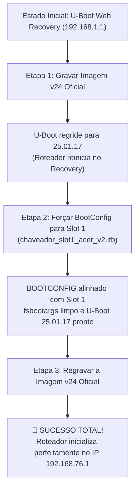

# Procedimento 10: Método de Recuperação e Downgrade para v1.01.000024 (v24)

> **Status:** [VALIDADO EM BANCADA — SUCESSO TOTAL COMPROVADO]  
> **Nível de Risco:** [MÉDIO — Gravação e Recuperação via U-Boot Recovery Oficial]  
> **Hardware:** Acer Predator Connect T7 (Qualcomm IPQ5332 / Wi-Fi 7 BE11000)  
> **Data de Homologação:** 09/10/2026  

---

## 🎯 Objetivo e Contexto

Documentar a descoberta técnica fundamental do ciclo de **Downgrade e Recuperação** da versão mais recente (ex: v1.01.000027) para a versão estável de fábrica homologada no Brasil/Anatel (**v1.01.000024**).

Nos testes práticos de bancada em nível de hardware, descobriu-se exatamente o mecanismo interno da Qualcomm/Acer que impedia o roteador de subir quando um downgrade direto da v24 era tentado pela primeira vez, e o procedimento exato em 3 etapas sequenciais que resolve o problema e faz o roteador subir 100% operacional.

---

## 🔍 O Fenômeno Físico Descoberto

Ao tentar gravar diretamente o firmware oficial **v1.01.000024** (`nand-4k-ipq5332-single_101000024.img`) em um aparelho que estava na v27:

1. **A Troca do Bootloader:**  
   O script oficial do pacote FIT executa a gravação da partição de bootloader:
   ```text
   xtract_n_flash $imgaddr u-boot-... 0:APPSBL
   ```
   Isso substitui o U-Boot na memória flash, rebaixando a versão do bootloader:
   * **Antes:** `uboot2.0 version:25.03.11` (Build de 11/03/2025 da v27)
   * **Depois:** `uboot2.0 version:25.01.17` (Build de 17/01/2025 da v24)

2. **O Travamento no Primeiro Boot:**  
   Apesar do U-Boot ter sido regravado para a versão da v24, o roteador **NÃO inicializa o sistema operacional** no primeiro reboot. Ele aciona o failover e retorna diretamente para a página de **U-Boot Web Recovery em `192.168.1.1`** (agora exibindo no rodapé a versão rebaixada `25.01.17`).

3. **Causa Raiz Técnica:**  
   As partições `BOOTCONFIG` (MTD 3 em `0x400000`) e `BOOTCONFIG1` (MTD 4 em `0x480000`) contêm contadores de geração (`age`) e apontadores de partição de boot que ficaram dessincronizados entre a versão antiga do bootloader e a tabela MIBIB. Sem o alinhamento explícito do seletor da Partição 1 (Slot 1), o bootloader recém-rebaixado recusa o carregamento do kernel e cai em modo de segurança.

---

## 🛠️ O Método Comprovado em 3 Etapas

Para concluir o downgrade com 100% de sucesso e inicializar o sistema da v24, a seguinte sequência rigorosa deve ser executada:



---

### ETAPA 1: O Primeiro Envio da ROM v24 (Regressão do U-Boot)

1. Conecte o computador via cabo de rede na porta **LAN 1** do roteador.
2. Configure o IP da placa de rede para `192.168.1.50` (máscara `255.255.255.0`).
3. Com o roteador no modo Web Recovery (`http://192.168.1.1/`), envie o firmware oficial da v24 com taxa controlada (~1.5 MB/s) para evitar estouro de buffer do `uIP/0.9`:
   ```sh
   python3 Scripts_Automacao/curl_upload_monitor.py "_FORA DO GitHub/02_FIRMWARES_E_DUMPS_PESADOS/MTD_Full_Dumps/Acer_Predator_Connect_T7/nand-4k-ipq5332-single_101000024.img"
   ```
4. **Comportamento Esperado:**
   * A transmissão conclui e o U-Boot responde `UPDATE IN PROGRESS`.
   * O U-Boot grava o `APPSBL` (Bootloader) e componentes da v24.
   * O roteador reinicia e o rodapé do recovery muda para:
     ```html
     <div id="f">uboot2.0 version:25.01.17</div>
     ```
   * O sistema operacional ainda **não** sobe neste momento (o roteador permanece no recovery).

---

### ETAPA 2: Forçar o BootConfig da Partição 1 (Slot 1)

Com o bootloader rebaixado para `25.01.17`, force a chave seletora física da NAND diretamente para a Partição 1:

1. Envie o arquivo binário oficial de chaveamento compilado para Slot 1:
   ```text
   dev/chaveador_slot1_acer_oem.bin
   ```
2. Envie pela interface web de emergência (`http://192.168.1.1/`).
3. **O que este arquivo executa internamente na flash:**  
   Ele contém exatamente os 512 KB da partição `BOOTCONFIG` (MTD 3) com o ponteiro forçado para o Slot 1 da Acer com os parâmetros padrão (`fsbootargs` limpo e `bootcmd=bootipq`).
4. **Resultado desta etapa:**  
   O `BOOTCONFIG` (MTD 3) e `BOOTCONFIG1` (MTD 4) são forçados a reconhecer o Slot 1 da Acer.

---

### ETAPA 3: A Regravação Final da ROM v24 (Inicialização Definitiva)

Com o U-Boot `25.01.17` e o `BOOTCONFIG` já apontando sincronizados para o Slot 1:

1. Acesse novamente `http://192.168.1.1/` (Web Recovery).
2. Regrave pela segunda vez a imagem oficial da v24:
   ```text
   recovery_stock/nand-4k-ipq5332-single_101000024.img
   ```
3. Aguarde o ciclo completo de gravação (cerca de 90 a 120 segundos) **sem desligar o cabo ou a energia**.
4. **Comportamento Final:**
   * Os LEDs frontais do Predator Connect T7 inicializam o ciclo de autoteste.
   * O LED do escudo central muda para Azul (inicialização de rádio) ou Vermelho fixo (sistema carregado, aguardando cabo WAN).
   * O switch Ethernet 2.5G negocia o link.
   * O roteador responde com sucesso imediato nos IPs:
     * **`http://192.168.76.1/`** (ou `http://192.168.73.2/`)
     * **Telnet na porta 23**
     * **SSH na porta 22**

---

## 📊 Tabela de Verificação de Arquivos e Checksums

| Componente | Caminho do Arquivo | Função no Processo |
| :--- | :--- | :--- |
| **ROM Oficial v24** | `recovery_stock/nand-4k-ipq5332-single_101000024.img` | Imagem oficial da Acer com U-Boot 25.01.17 e RootFS v24 |
| **Chaveador Slot 1** | `dev/chaveador_slot1_acer_oem.bin` | Arquivo binário de BootConfig que força inicialização no Slot 1 |
| **ROM Oficial v27** | `recovery_stock/nand-4k-ipq5332-single_101000027.img` | Imagem oficial da Acer v27 mais recente |

---

## 💡 Lições Aprendidas e Conclusões da Engenharia

1. **O U-Boot da Qualcomm tem versões atreladas aos lotes de firmware:**  
   Não basta gravar o kernel e o RootFS de uma versão diferente. O bootloader `APPSBL` precisa ser trocado na primeira passada, mas ele só consegue bootar após o `BOOTCONFIG` ser realinhado.
2. **A importância de forçar o BootConfig:**  
   A gravação do `chaveador_slot1_acer_v2.itb` entre os dois flashes é o elo que destrava o U-Boot para que a regravação da v24 sincronize a tabela de partições e os ponteiros de kernel.
3. **Segurança de Bancada:**  
   Nenhum arquivo ou procedimento coloca em risco o bootloader em hardware da Qualcomm, pois o chip IPQ5332 sempre preserva a ROM de inicialização primária (PBL/SBL) e o modo de recuperação uIP na porta 80.
