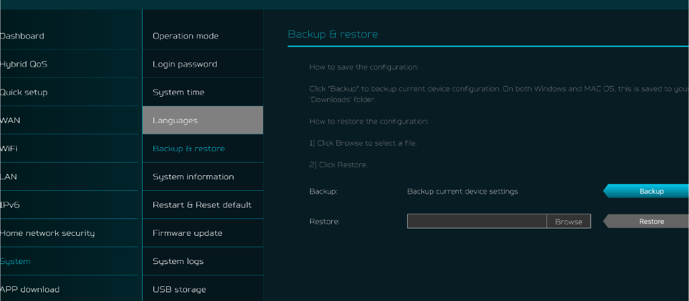

# Procedimento: Restauração de Configuração (.CFG) na Interface OEM Acer Predator Connect T7

Este documento registra o caminho exato e as instruções para restaurar pacotes de configuração (`.cfg`) através da interface web oficial (OEM) do **Acer Predator Connect T7**.

---

## 📸 Tela Oficial de Backup & Restauração (OEM)

A captura de tela da interface oficial da Acer foi preservada no repositório em:
- Arquivo no repositório: [`assets/tela_carregamento_backup_oem.png`](../assets/tela_carregamento_backup_oem.png)



---

## 🌐 Endereço URL Direto da Tela

Você pode acessar diretamente a página colando o seguinte endereço no navegador (estando conectado via cabo ou Wi-Fi na LAN do roteador):

```text
https://192.168.76.1/pub/dist/index.html#/system/backRestore
```

> **Nota:** Caso o navegador exiba aviso de certificado SSL autoassinado, clique em *"Avançado / Continuar para 192.168.76.1"*.

---

## 🗂️ Caminho Visual pelos Menus Laterais

Caso prefira navegar visualmente pelos menus da interface Acer:

1. Acesse `https://192.168.76.1` e faça login.
2. Na barra lateral esquerda principal, clique em:
   👉 **`System`** (ou **`Sistema`**)
3. No submenu que se expande ao lado, selecione:
   👉 **`Backup & restore`** (ou **`Backup & restauração`**)
4. A tela exibirá duas seções:
   - **Backup**: Para salvar a configuração atual do roteador.
   - **Restore**: Para enviar um arquivo `.cfg` de recuperação.

---

## 🚀 Como Aplicar o Pacote Mestre de Restauração

1. Na seção **Restore**:
   - Clique no botão **`Browse`**.
   - Selecione o pacote no seu computador:
     ```text
     cfg_restauracao_master_v2.cfg (na raiz do repositório)
     ```
2. Clique no botão cinza/azul **`Restore`**.
3. Uma barra de progresso será exibida. Aguarde cerca de **40 a 60 segundos** (no padrão de 80 MHz non-DFS).
4. O roteador aplicará todas as configurações, liberará o acesso LuCI na porta 80 e 443, reativará o SSH (porta 22) e Telnet (porta 23) na LAN, subirá a Central Wi-Fi com blindagem de deadlocks (`predator-wifi-guard`), e reiniciará os serviços automaticamente.

---

## 🔐 Credenciais Padrão Após a Restauração

- **Interface LuCI (OpenWrt):** `http://192.168.76.1` ou `https://192.168.76.1`
  - Usuário: `root` (ou `admin`)
  - Senha: `root0100`
- **Terminal SSH (Dropbear - restrito à LAN):**
  - Host: `192.168.76.1`
  - Porta: `22`
  - Usuário: `root` (ou `admin` / `Admin`)
  - Senha: `root0100`
- **Documentação de Boot e LEDs Físicos:**
  - Consulte [`docs/TEMPOS_BOOT_WIFI_E_LEDS.md`](TEMPOS_BOOT_WIFI_E_LEDS.md) para detalhes da cronometria e comportamento das luzes do equipamento.
- **Redes Wi-Fi:**
  - Rede Unificada (Tri-Band): `Predator_7G` (2.4 GHz, 5 GHz e 6 GHz)
  - Largura de Banda 5 GHz Padrão: `80 MHz` (Canal 36 non-DFS: inicialização rápida sem espera de radar DFS, configurável para 160 MHz no LuCI)
  - Senha Wi-Fi: `Predator0@`
  - SQM (Cake QoS): Desativado por padrão (aceleração por hardware PPE máxima)
